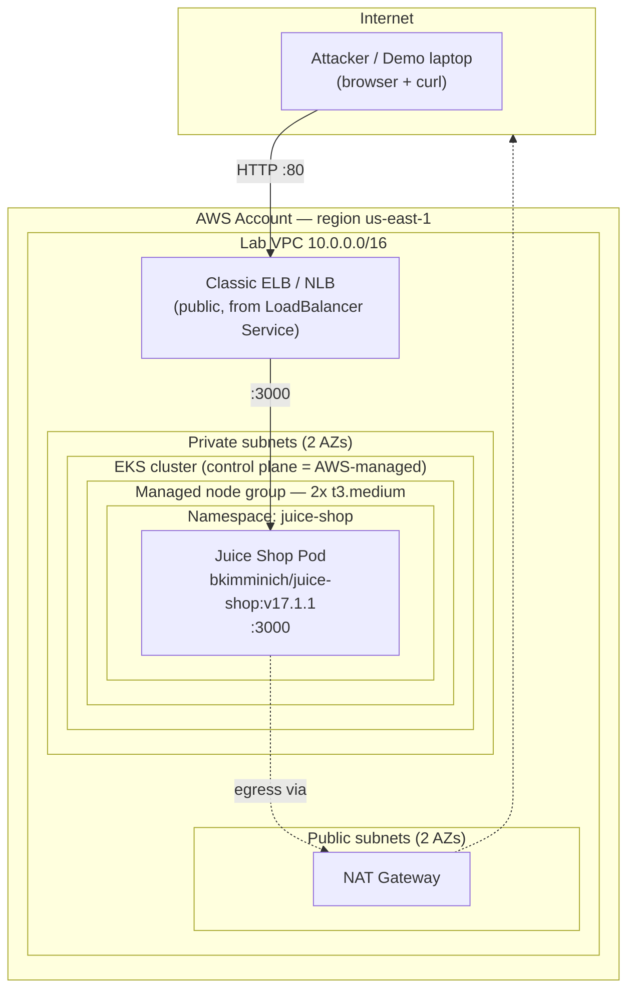

# Lab Architecture

## Topology diagram

> This is the **as-built lab** — intentionally minimal and vulnerable. The more
> secure target architecture (WAF, runtime detection, IRSA, etc.) is
> covered as recommendations in [slides-outline.md](slides-outline.md), not deployed
> here. The point of the lab is to exploit the vulnerable baseline first.

## Request path

1. Demo laptop hits the public ELB DNS name over HTTP/80.
2. The `LoadBalancer` Service forwards to the Juice Shop Pod on container port 3000.
3. The Pod runs on a worker node in a **private** subnet; it has no public IP.
4. Pod egress (if any) leaves through the single NAT gateway.
5. The EKS **control plane** is AWS-managed; its public API endpoint is locked to
   `admin_cidr` (your IP) so only you can `kubectl`.

## Component inventory

| Layer | Component | Purpose |
|-------|-----------|---------|
| Network | VPC, 2 public + 2 private subnets, IGW, 1 NAT GW | Isolation; nodes stay private |
| Control plane | EKS managed control plane (v1.36, standard support) | API server, scheduler, etcd (AWS-run) |
| Compute | Managed node group, 2× t3.medium | Runs the workload pods |
| Add-ons | CoreDNS, kube-proxy, VPC CNI, Pod Identity Agent | Core cluster function |
| Workload | Juice Shop Deployment + Service | The vulnerable target app |
| Exposure | Classic ELB (in-tree) | Public entry point for the demo |
| Controls (hardened overlay) | PSA `restricted`, securityContext, NetworkPolicy | Blast-radius reduction |

> Runtime detection and the other production controls are **not deployed in
> this lab** — they live in the secure-architecture recommendations, so the baseline
> stays exploitable for the demo.

## Design choices & tradeoffs (talk track)

- **EKS over self-managed k8s / kOps.** Managed control plane removes etcd/API
  babysitting so the week goes into the security story, not cluster plumbing.
  Tradeoff: less control over control-plane internals, small hourly cost.
- **Terraform over eksctl/ClickOps.** Reproducible, reviewable, destroyable in one
  command — the right signal for a solutions-architect role. Tradeoff: more upfront code.
- **Managed node group over Fargate.** Juice Shop is a single stateful-ish container
  and the exploits are more interesting on a real node (host namespaces, node-level
  runtime visibility). Fargate would hide the node layer. Tradeoff: I patch/scale nodes.
- **Private nodes + single NAT.** Realistic posture (nodes never public) while keeping
  lab cost down. Tradeoff: single NAT is a non-HA SPOF — fine for a lab, not prod.
- **LoadBalancer Service (Classic ELB) over ALB Ingress Controller.** Zero extra
  moving parts for a reliable live demo. Tradeoff: no path routing / WAF hook; I call
  out the ALB + AWS Load Balancer Controller as the production upgrade.
- **Public API endpoint locked to my IP.** I need kubectl from my laptop; restricting
  the CIDR keeps it from being internet-wide. Tradeoff: private-only is stricter but
  needs a bastion/VPN, which is overkill for a one-week lab.
